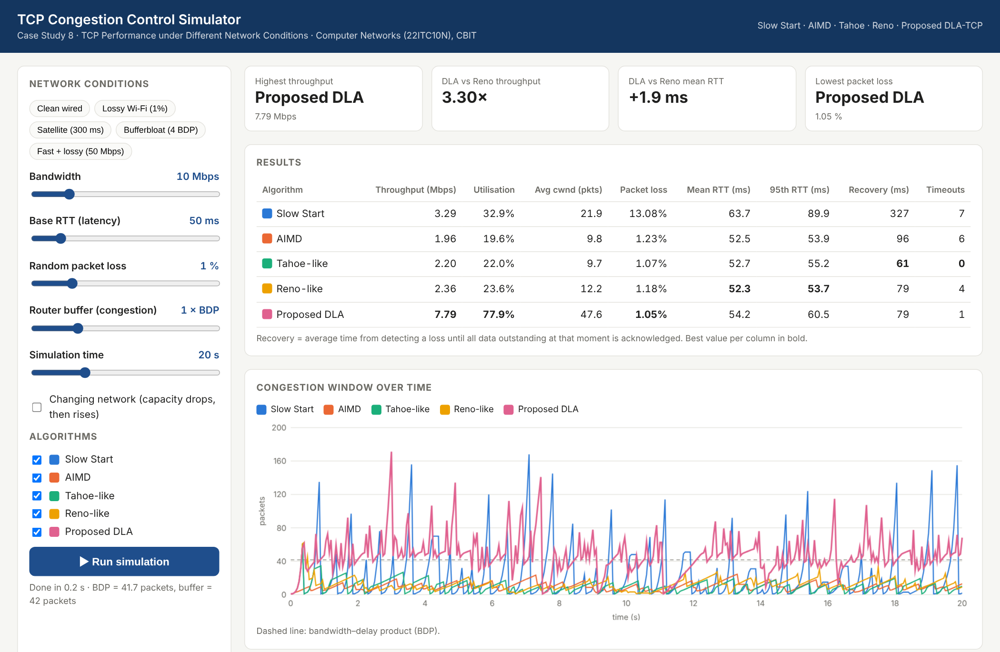
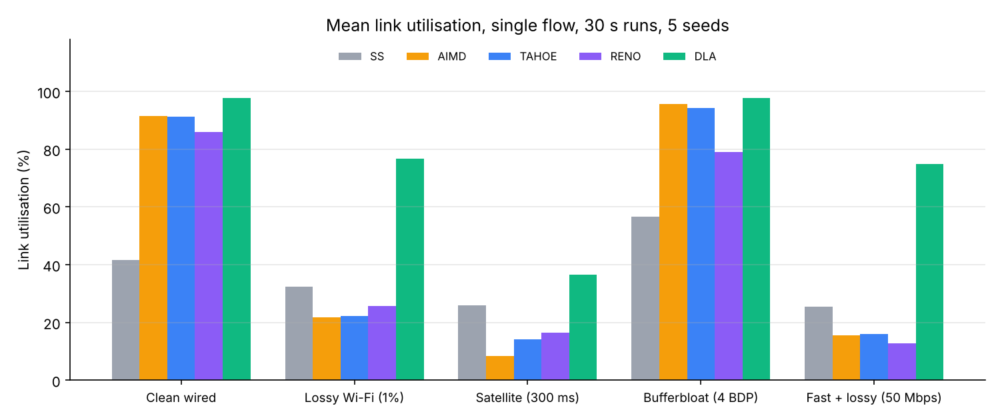
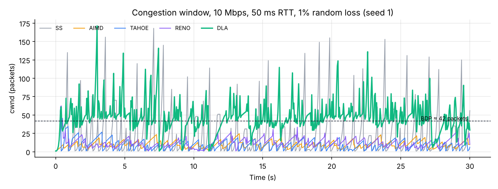
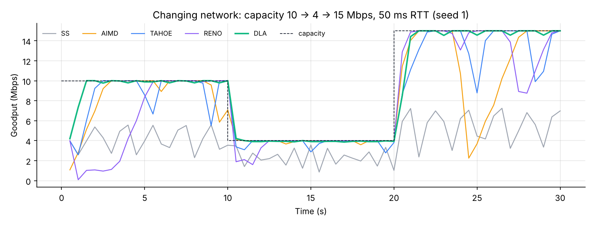

# TCP congestion control simulator

A packet-level discrete-event simulator that compares five TCP congestion control algorithms (Slow Start only, AIMD, Tahoe, Reno and a proposed Delay- and Loss-Aware variant, DLA) on one bottleneck link. Bandwidth, round-trip time, random loss and router buffer size can all be varied. It comes with a local web demo for running experiments interactively and a script that reproduces every number and figure below.

Built for Case Study 8, "TCP performance under different network conditions", in Computer Networks (22ITC10N) at Chaitanya Bharathi Institute of Technology (CBIT), Hyderabad.



## Contents

- [Quick start](#quick-start)
- [What is simulated](#what-is-simulated)
- [The algorithms](#the-algorithms)
- [Results](#results)
- [Reproducing the results](#reproducing-the-results)
- [Using the simulator from Python](#using-the-simulator-from-python)
- [Project structure](#project-structure)
- [Limitations](#limitations)
- [References](#references)

## Quick start

Requirements: Python 3.8 or newer. The simulator and the web demo use only the standard library, so there is nothing to install.

```bash
git clone https://github.com/hamza1jaweed/tcp-congestion-control-simulator.git
cd tcp-congestion-control-simulator/demo
python app.py          # on some systems: python3 app.py
```

Your browser opens http://localhost:8000. Pick a preset or move the sliders, then press "Run simulation". A 20-second run of all five algorithms takes well under a second. On Windows you can double-click `demo/run_demo.bat` instead.

The demo shows, for each algorithm:
- throughput, link utilisation, average congestion window, packet loss
- mean and 95th-percentile RTT, loss-recovery time and timeout count
- congestion window over time
- throughput over time

Ticking "Changing network" drops the link to 40% of its capacity a third of the way through the run and raises it to 150% at two-thirds.

## What is simulated

The topology is a dumbbell: one or more senders share a single bottleneck link.

| Component | Model |
| --- | --- |
| Bottleneck link | FIFO drop-tail queue of B packets; capacity, base RTT and random loss probability can all change over time (piecewise-constant schedules) |
| Buffer size | Set in multiples of the bandwidth-delay product (BDP); at 10 Mbps and 50 ms one BDP is about 42 packets |
| Random loss | Independent per-packet drops, modelling non-congestive loss such as Wi-Fi corruption |
| Packets | 1 packet = 1 MSS = 1500 bytes, numbered per packet |
| Receiver | Cumulative ACKs, one ACK per data packet, out-of-order buffering; ACKs echo the send timestamp (as in RFC 7323), so RTT samples stay valid after retransmissions |
| Sender | RFC 6298 retransmission timer (minimum RTO 200 ms, exponential back-off up to 64x), fast retransmit after 3 duplicate ACKs |

Events (packet arrivals, ACKs and timer expiries) sit in a priority queue (`heapq`) and are processed in time order. Every random draw comes from a seeded `random.Random`, so a given seed always produces the same run.

## The algorithms

| Algorithm | Growth | On 3 duplicate ACKs | On timeout |
| --- | --- | --- | --- |
| SS (Slow Start only) | +1 MSS per ACK (doubles each RTT); no congestion avoidance | cwnd = 1, go-back-N | cwnd = 1 |
| AIMD | +1 MSS per RTT from the start, no slow start | cwnd = cwnd / 2, retransmit | cwnd = cwnd / 2 |
| Tahoe | Slow start below ssthresh, then +1 MSS per RTT | ssthresh = flight / 2, cwnd = 1, go-back-N | ssthresh = flight / 2, cwnd = 1 |
| Reno | As Tahoe | Fast recovery: ssthresh = flight / 2, cwnd = ssthresh + 3, inflate per duplicate ACK, deflate on new ACK | As Tahoe |
| DLA (proposed) | Delay-aware, see below | Halves only for congestive loss | As Tahoe |

### The proposed DLA mechanism

DLA measures normalised queueing delay, d = (RTT − minRTT) / minRTT, using a windowed minimum RTT. It combines five changes, each of which can be switched off through `dla_params` for ablation studies:

| ID | Change | Rule (default parameters in `DLA_DEFAULT`) |
| --- | --- | --- |
| C1 | Delay-aware slow-start exit | Leave slow start once d > 0.25, before the buffer overflows |
| C2 | Adaptive additive increase | Increase by α per RTT, with α falling linearly from 4 to 1 as d rises from 0 to 0.10 |
| C3 | Delay-triggered early back-off | When d > 0.50, set cwnd = max(2, min(0.85 · cwnd, 0.9 · BDP_est)) to drain the standing queue before it causes loss |
| C4 | Loss differentiation | A loss with d < 0.20 is treated as non-congestive: ssthresh becomes the larger of cwnd / 2 and min(0.9 · cwnd, BDP_est), so the window usually stays near the BDP instead of halving |
| C5 | Partial-ACK recovery | NewReno-style handling (RFC 6582) of several losses in one window, avoiding repeated halving or a timeout |

BDP_est is the bandwidth estimate multiplied by minRTT. A competition guard pauses C3 for 10 seconds if more than three early back-offs in a row fail to lower the delay. That situation means a loss-based flow is sharing the link, and continuing to yield would starve DLA.

## Results

Each result is a single flow on a 30-second run, averaged over 5 seeds. The five scenarios are the presets in the web demo. Best value in each row in bold.



| Scenario | SS | AIMD | TAHOE | RENO | DLA |
|---|---|---|---|---|---|
| Clean wired (10 Mbps, 50 ms) | 42% | 92% | 91% | 86% | **98%** |
| Lossy Wi-Fi (1% random loss) | 32% | 22% | 22% | 26% | **77%** |
| Satellite (300 ms RTT, 0.1% loss) | 26% | 8% | 14% | 17% | **37%** |
| Bufferbloat (buffer = 4 BDP) | 57% | 96% | 94% | 79% | **98%** |
| Fast + lossy (50 Mbps, 0.1% loss) | 25% | 16% | 16% | 13% | **75%** |

Delay and timeouts in two of the scenarios (goodput shown as mean ± standard deviation across seeds):

| Scenario | Algorithm | Goodput (Mbps) | Mean RTT (ms) | p95 RTT (ms) | Timeouts |
|---|---|---|---|---|---|
| Bufferbloat (4 BDP) | SS | 5.66 ± 0.00 | 151 | 242 | 0.0 |
| Bufferbloat (4 BDP) | AIMD | 9.56 ± 0.01 | 163 | 243 | 0.0 |
| Bufferbloat (4 BDP) | TAHOE | 9.43 ± 0.18 | 175 | 243 | 0.2 |
| Bufferbloat (4 BDP) | RENO | 7.90 ± 0.02 | 153 | 226 | 1.0 |
| Bufferbloat (4 BDP) | DLA | 9.78 ± 0.00 | **66** | **77** | 0.0 |
| Lossy Wi-Fi (1%) | SS | 3.24 ± 0.15 | 64 | 90 | 13.4 |
| Lossy Wi-Fi (1%) | AIMD | 2.19 ± 0.19 | 52 | 54 | 5.6 |
| Lossy Wi-Fi (1%) | TAHOE | 2.22 ± 0.14 | 53 | 55 | 1.4 |
| Lossy Wi-Fi (1%) | RENO | 2.57 ± 0.13 | 52 | 54 | 2.4 |
| Lossy Wi-Fi (1%) | DLA | **7.67 ± 0.31** | 54 | 61 | 2.6 |

What the numbers show:

1. **Random loss.** With 1% random loss, Tahoe and Reno use only 22 to 26% of the link. Every corrupted packet is treated as congestion and halves the window, so cwnd stays far below the 42-packet BDP (see the figure below). DLA's loss differentiation (C4) keeps the window near the BDP and reaches 77%, about 3x Reno.
2. **Bufferbloat.** With a 4-BDP buffer, the loss-based algorithms fill the queue before backing off, so the mean RTT triples from 50 ms to 150-175 ms. DLA's early back-off (C3) keeps the mean RTT at 66 ms while still getting the highest goodput.
3. **Long or fast paths.** Additive increase of 1 MSS per RTT is slow when the BDP is large: 250 packets on the satellite link, 208 on the 50 Mbps link. One loss costs many seconds of regrowth. DLA's adaptive increase (C2) recovers faster. Utilisation is still low for every algorithm on the satellite link, because a 30-second run is only 100 RTTs long.
4. **Reno below Tahoe.** Reno sometimes scores lower than Tahoe. Classic Reno handles one loss per window well, but when several packets in a window are lost it leaves fast recovery after the first retransmission and often ends in a timeout. This is the weakness that NewReno (RFC 6582) and DLA's partial-ACK handling (C5) fix.
5. **Slow Start only** never settles. It overshoots, loses a burst of packets and restarts from cwnd = 1, which is why it shows the most timeouts (13.4 per run on the lossy link).



When capacity changes mid-run (10, then 4, then 15 Mbps), DLA follows each step closely. AIMD, Tahoe and Reno show deep throughput dips after the capacity increase, caused by overshoot losses:



The full table for all 25 scenario and algorithm combinations, including loss rate and p95 RTT, is in [`results/results.csv`](results/results.csv).

## Reproducing the results

```bash
pip install matplotlib                  # only needed for the figures
python results/run_experiments.py       # about 25 seconds
```

The script writes `results/results.csv`, `results/results.md` and the three figures in `docs/`. Fixed seeds (1 to 5) make the output identical on every run.

## Using the simulator from Python

```python
import sys
sys.path.insert(0, "demo")
from tcpsim import Simulator, summarize

sim = Simulator(cap_mbps=10, rtt_ms=50, loss_p=0.01, buffer_bdp=1.0, duration=30, seed=1)
flow = sim.add_flow("DLA")              # "SS", "AIMD", "TAHOE", "RENO" or "DLA"
sim.run()
print(summarize(sim, flow))             # goodput, loss rate, mean/p95 RTT, timeouts, ...
```

More options:
- Several `add_flow` calls on the same simulator share the bottleneck. `tcpsim.jain()` computes Jain's fairness index over their goodputs.
- Capacity, RTT and loss accept schedules such as `cap_mbps=[(0, 10), (10, 4), (20, 15)]`.
- Ablation study: `sim.add_flow("DLA", dla_params={"loss_diff": False})` turns off one DLA component.

## Project structure

```
tcp-congestion-control-simulator/
├── demo/
│   ├── tcpsim.py            discrete-event simulator and all five algorithms
│   ├── app.py               local web server (standard library only), POST /run
│   ├── index.html           demo interface: sliders, presets, tables, charts
│   ├── run_demo.bat         Windows launcher
│   └── README.txt           short demo instructions
├── results/
│   ├── run_experiments.py   reproduces the tables and figures in this README
│   ├── results.csv          full results, 5 scenarios x 5 algorithms
│   └── results.md           tables used above
├── docs/                    figures and screenshot
├── requirements.txt         matplotlib, only for the experiment figures
├── LICENSE
└── README.md
```

## Limitations

- The results above use a single flow per run. DLA's behaviour when it shares a link with Reno flows depends on the competition guard and is not covered by these tables.
- DLA's thresholds were tuned on these same scenarios, so the comparison favours it. A fair evaluation would tune on one set of conditions and test on another.
- Losses are independent per packet. Real wireless losses come in bursts, and real routers often use active queue management (for example CoDel or FQ-CoDel) rather than drop-tail.
- Each packet is a full 1500-byte MSS, with no delayed ACKs, receiver-window limit, ACK loss or reordering on the reverse path.
- This is a simulation, not an implementation: the algorithms have not been tested in a real network stack such as Linux, ns-3 or Mininet.

## References

- Jacobson, V. (1988). Congestion avoidance and control. Proceedings of ACM SIGCOMM '88, 314-329.
- Allman, M., Paxson, V. and Blanton, E. (2009). RFC 5681: TCP Congestion Control. IETF.
- Paxson, V., Allman, M., Chu, J. and Sargent, M. (2011). RFC 6298: Computing TCP's Retransmission Timer. IETF.
- Henderson, T., Floyd, S., Gurtov, A. and Nishida, Y. (2012). RFC 6582: The NewReno Modification to TCP's Fast Recovery Algorithm. IETF.
- Borman, D., Braden, B., Jacobson, V. and Scheffenegger, R. (2014). RFC 7323: TCP Extensions for High Performance. IETF.
- Mascolo, S., Casetti, C., Gerla, M., Sanadidi, M. Y. and Wang, R. (2001). TCP Westwood: bandwidth estimation for enhanced transport over wireless links. Proceedings of ACM MobiCom 2001, 287-297.
- Cardwell, N., Cheng, Y., Gunn, C. S., Yeganeh, S. H. and Jacobson, V. (2016). BBR: congestion-based congestion control. ACM Queue, 14(5), 20-53.
- Jain, R., Chiu, D. and Hawe, W. (1984). A quantitative measure of fairness and discrimination for resource allocation in shared computer systems. DEC Research Report TR-301.

## Licence

MIT. See [LICENSE](LICENSE).
